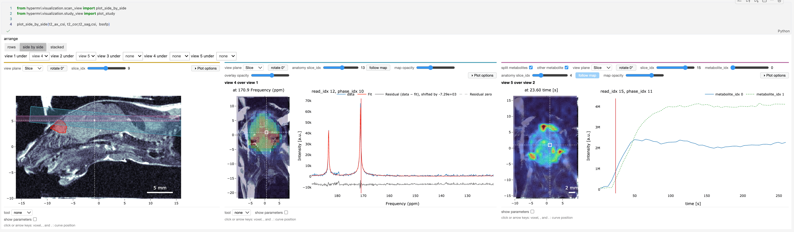

# HyperMRI 🧲

[](https://pypi.org/project/hypermri/)
[](https://hypermri.readthedocs.io/en/stable/)
[](https://github.com/LucaNagel/hypermri/actions/workflows/test.yml)
[](https://github.com/LucaNagel/hypermri/blob/main/LICENSE)

**Python research tools for loading, reconstructing, and visualizing MRI data.**

[](https://hypermri.readthedocs.io/en/stable/)

*Three linked views in Jupyter: an anatomy with the outlines of the other
slices, a CSI map with the fitted spectrum of the selected voxel, and a
dynamic map with its time course. Try the viewer interactively on the
[documentation home page](https://hypermri.readthedocs.io/en/stable/).*

## Research-use notice

HyperMRI is research software. It has not been validated or approved as a
medical device and is not intended for clinical diagnosis, treatment
decisions, or other clinical use. Its outputs may be incomplete, incorrect, or
unsuitable for a particular experiment. Users are responsible for independently
validating the methods and results and for complying with applicable ethical,
privacy, institutional, and regulatory requirements.

Do not publish patient data, identifying metadata, or confidential research
data in GitHub issues, discussions, or examples.

## Features

* **Bruker-first loading and reconstruction**: scoped stable support for
  Bruker ParaVision data, with automatic vendor and sequence detection.
  Siemens support is Beta; Agilent/Varian, Magritek, and Bruker TopSpin
  support is Experimental. See the
  [support matrix](https://hypermri.readthedocs.io/en/stable/support.html)
  before relying on a workflow.
* **[xarray](https://docs.xarray.dev/en/stable/) data model**: MRI data is
  represented as labelled `xarray.DataArray` and `xarray.Dataset` objects with
  metadata and physical coordinates.
* **Interactive visualization**: the Plotly-based viewer supports
  multidimensional images, spectra, fit curves, and overlays in Jupyter.
* **Analysis and export**: reusable reconstruction and fitting workflows plus
  derived DICOM export for supported geometries.

## Documentation

The documentation is hosted on Read the Docs:

* [hypermri.readthedocs.io/en/stable](https://hypermri.readthedocs.io/en/stable/)
  describes the latest release on PyPI.
* [hypermri.readthedocs.io/en/latest](https://hypermri.readthedocs.io/en/latest/)
  follows the `develop` branch.


## Installation

```bash
pip install hypermri
```

The steps below start from a computer without Python, conda or Git. HyperMRI
needs **Python 3.12**; conda installs it for you, so you do not need to
install Python separately.

### 1. Install conda

We recommend [Miniforge](https://conda-forge.org/download/), a free conda
installer that uses the community package channel conda-forge. Download the
installer for your computer:

| System | Installer |
| --- | --- |
| Windows | [Miniforge3-Windows-x86_64.exe](https://github.com/conda-forge/miniforge/releases/latest/download/Miniforge3-Windows-x86_64.exe) |
| macOS, Apple chip (M1 or newer) | [Miniforge3-MacOSX-arm64.sh](https://github.com/conda-forge/miniforge/releases/latest/download/Miniforge3-MacOSX-arm64.sh) |
| macOS, Intel chip | [Miniforge3-MacOSX-x86_64.sh](https://github.com/conda-forge/miniforge/releases/latest/download/Miniforge3-MacOSX-x86_64.sh) |
| Linux, x86-64 PC | [Miniforge3-Linux-x86_64.sh](https://github.com/conda-forge/miniforge/releases/latest/download/Miniforge3-Linux-x86_64.sh) |
| Linux, ARM | [Miniforge3-Linux-aarch64.sh](https://github.com/conda-forge/miniforge/releases/latest/download/Miniforge3-Linux-aarch64.sh) |

On a Mac, the Apple menu > *About This Mac* shows whether the computer has
an Apple chip or an Intel processor.

* **Windows:** run the downloaded `.exe` file, choose *Just Me* and keep the
  default options.
* **macOS and Linux:** open a terminal and run the downloaded file, for
  example on a Mac with an Apple chip:

  ```bash
  bash ~/Downloads/Miniforge3-MacOSX-arm64.sh
  ```

  Accept the licence and answer `yes` when the installer asks whether to
  initialize conda. Then close the terminal and open a new one.

If you prefer the graphical
[Anaconda Navigator](https://www.anaconda.com/docs/tools/anaconda-navigator/main)
to the terminal, install the
[Anaconda Distribution](https://www.anaconda.com/download/success) instead and
follow [Installation with Anaconda Navigator](#installation-with-anaconda-navigator)
below. Check the
[Anaconda terms of service](https://www.anaconda.com/legal/terms/terms-of-service)
first: organizations with more than 200 employees may need a paid licence.

### 2. Open a terminal

All commands below are the same on every system. Type them into:

* **Windows:** *Miniforge Prompt* from the Start menu,
* **macOS:** *Terminal* (press Cmd+Space and type `Terminal`),
* **Linux:** the terminal of your desktop, often Ctrl+Alt+T.

The line in the terminal starts with `(base)` when conda is ready.

### 3. Create an environment and install HyperMRI

An environment keeps HyperMRI and its dependencies separate from other
Python projects. Create one named `hypermri`, activate it and install the
package:

```bash
conda create -n hypermri python=3.12
```

```bash
conda activate hypermri
```

```bash
pip install hypermri
```

This installs everything for loading, reconstruction, fitting, the
interactive viewer, Jupyter and Siemens TWIX files. Optional: SimpleITK
motion correction needs `pip install "hypermri[motion]"`.

### 4. Start Jupyter

```bash
jupyter notebook
```

Jupyter opens in your web browser. In VS Code, select the `hypermri`
environment as the notebook kernel instead.

Each new terminal starts in the `(base)` environment. Run
`conda activate hypermri` again before you start Jupyter or Python.

### Alternative: Installation with Anaconda Navigator (Graphical User Interface)

1. Open [Anaconda Navigator](https://www.anaconda.com/download) and go to *Environments*.
2. Click *Create*, enter the name `hypermri`, select Python 3.12 and click
   *Create*.
3. Click the ▶ button next to `hypermri` and choose *Open Terminal*.
4. In this terminal, run `pip install hypermri` and then `jupyter notebook`.

Next time, open the terminal of the `hypermri` environment the same way and
run `jupyter notebook`.

### Alternative: Installation with uv

<details>
<summary>Show the steps for <a href="https://docs.astral.sh/uv/">uv</a>, a fast Python package manager</summary>

[uv](https://docs.astral.sh/uv/getting-started/installation/) downloads
Python 3.12 itself, so neither conda nor Python is needed. In a new project
folder, create an environment:

```bash
uv venv --python 3.12
```

Activate it on macOS or Linux:

```bash
source .venv/bin/activate
```

or on Windows:

```bash
.venv\Scripts\activate
```

Then install HyperMRI and start Jupyter:

```bash
uv pip install hypermri
```

```bash
jupyter notebook
```

Run the activation command again in every new terminal. In a clone of the
repository, `uv pip install -e ".[dev,docs]"` installs it for development.

</details>

### Install from source (developers)

To edit the code or build the documentation, install Git into the
environment and clone the repository:

```bash
conda activate hypermri
```

```bash
conda install git
```

```bash
git clone https://github.com/LucaNagel/hypermri.git
```

```bash
cd hypermri
```

```bash
pip install -e ".[dev,docs]"
```

To contribute changes, first
[fork the repository](https://github.com/LucaNagel/hypermri/fork) on GitHub
and clone your fork instead; see
[CONTRIBUTING.md](https://github.com/LucaNagel/hypermri/blob/main/CONTRIBUTING.md).

The [installation guide](https://hypermri.readthedocs.io/en/stable/getting_started/installation.html)
covers troubleshooting and building the documentation locally.

## Usage

```python
from hypermri import Study

# Point Study to a Bruker study folder that you are authorised to use, for
# example the public Lego phantom of the documentation.
study = Study("path/to/20200612_094625_lego_phantom_3_1_2")

# Show the CSI scan on its anatomical image
study[30].plot(anatomy=study[8])
```

The [first look](https://hypermri.readthedocs.io/en/stable/getting_started/first_look.html)
describes where to download the Lego phantom.

The separate optional real-data integration suite uses Tomáš Pšorn's public
[BrukerAPI ParaVision 6.0.1 Lego-phantom corpus](https://doi.org/10.5281/zenodo.4048253)
(version 1.1.0, CC BY 4.0); it is not downloaded during installation or normal
unit tests.

For stock Bruker CSI, `raw-reco` removes the first 70
digital-filter/transient samples once per FID and rebuilds the time and
frequency axes for the remaining samples. The original handler FID remains
complete, and scanner-reconstructed `2dseq` data is not cut again. See the
[support matrix](https://hypermri.readthedocs.io/en/stable/support.html)
for the exact reconstruction contract.

The tutorials in the documentation show more examples.

## Citation

If you use HyperMRI in your research, please cite it. The *Cite this
repository* button on the GitHub page gives APA and BibTeX entries from
[CITATION.cff](https://github.com/LucaNagel/hypermri/blob/main/CITATION.cff):

```bibtex
@software{hypermri,
  author  = {Nagel, Luca and {HyperMRI contributors}},
  title   = {{HyperMRI}: Python research tools for loading, reconstructing,
             and visualizing {MRI} data},
  url     = {https://github.com/LucaNagel/hypermri},
  license = {AGPL-3.0-only},
  version = {0.1.0}
}
```

Replace `version` with the release you used. This command prints it:

```bash
python -c "import hypermri; print(hypermri.__version__)"
```

If you use an example dataset, please also cite the dataset and its article
as given in [Usage](#usage) and the documentation.

## Contributing

Contributions are welcome. See [CONTRIBUTING.md](https://github.com/LucaNagel/hypermri/blob/main/CONTRIBUTING.md) for the review,
testing, data-safety, and licensing rules. Pull requests must pass the required
checks and be approved by the maintainer before they are merged into `main`.

Historical and current contributors are credited in
[CONTRIBUTORS.md](https://github.com/LucaNagel/hypermri/blob/main/CONTRIBUTORS.md).
Because the public repository starts with a history-free root commit, that file
is the canonical public attribution rather than the private development history.

## License

HyperMRI is licensed under the
[GNU Affero General Public License v3.0 only](https://github.com/LucaNagel/hypermri/blob/main/LICENSE)
(`AGPL-3.0-only`).

Third-party attribution and modification notices are retained in
[NOTICE](https://github.com/LucaNagel/hypermri/blob/main/NOTICE).
The adapted BrukerMRI parameter readers retain their
[Apache License 2.0 text and attribution](https://github.com/LucaNagel/hypermri/blob/main/LICENSES/brukerMRI-Apache-2.0.txt).
Both notices and licence texts are included in the source and wheel packages.

Commercial use is permitted under the license. Its copyleft and source-offer
requirements apply when covered modified versions are conveyed and when users
interact with a modified version over a network. It does not by itself prohibit
a purely private internal fork. The exact license text controls; this summary
is not legal advice.

Copyright © HyperMRI contributors.
