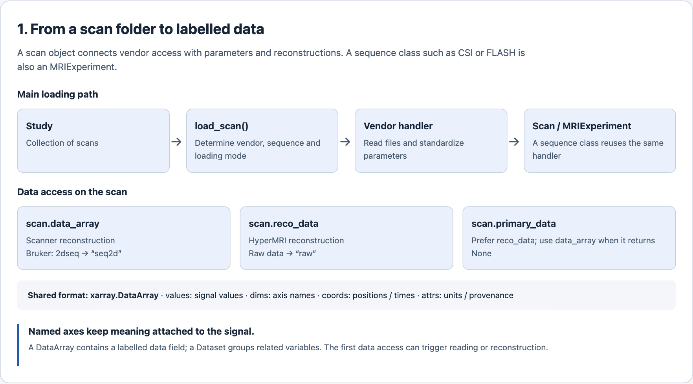
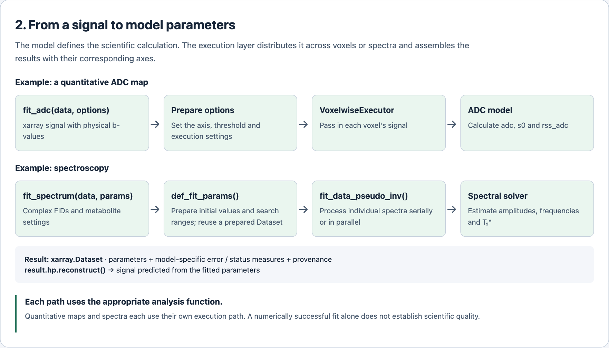

Architecture
============

Data flow in one direction, from files on disk to labelled arrays, analysis
results and the viewer:

.. code-block:: text

   Study and load_scan  ->  vendor handler  ->  sequence class
                        ->  reconstruction  ->  labelled xarray data
                        ->  analysis (fits, masks)  ->  viewer

Each layer imports only the ones before it. Analysis does not know the
viewer, and loading a scan does not start plotting.

From a scan folder to labelled data
-----------------------------------

         data from a scan.

:func:`~hypermri.load_scan` detects the vendor, builds the vendor handler
once and picks the sequence class from
``sequences/config/sequence_mapping.yaml``; a scan without an entry becomes a
plain :class:`~hypermri.MRIExperiment`. :class:`~hypermri.Study` calls the
same function for every scan of a session folder.

:doc:`loading_structure` walks through these steps with diagrams.

The **handler** reads the vendor files and translates their parameters into
shared names with units (``scan.repetition_time_ms``). The **scan** holds the
handler, its parameters, masks and reconstructions:

.. list-table::
   :header-rows: 1
   :widths: 25 75

   * - Attribute
     - Content
   * - ``scan.scanner_data``
     - scanner image (``"seq2d"``)
   * - ``scan.data``
     - HyperMRI's reconstruction of the acquired data (``"raw"``)
   * - ``scan.primary_data``
     - ``data`` if available, otherwise ``scanner_data``
   * - ``scan.handler``
     - vendor files, for Bruker ``scan.handler.method`` and ``scan.handler.fid``

The loading mode decides what is read at the start; later access may read or
reconstruct more (:doc:`reconstruction`). All arrays are
:class:`xarray.DataArray` objects with named dimensions, coordinates and
attributes (:doc:`data_model`).

From a signal to model parameters
---------------------------------

A fit takes a ``DataArray`` and returns an :class:`xarray.Dataset` with the
fitted parameters, status, diagnostics and the options used. The model owns
the equation and its units; an execution layer runs it for every voxel or
spectrum, serially or in parallel, and keeps the remaining dimensions.

- Quantitative maps: ``fit_adc``, ``fit_t1``, ``fit_t2``, ``fit_b1`` and
  ``fit_ideal`` in :mod:`hypermri.analysis.quantitative`.
  ``scan.fit_maps()`` and ``study.fit_maps()`` also check that a scan suits
  the model and store the result in ``scan.fit_results``.
- Spectroscopy: :func:`~hypermri.analysis.spectroscopy.fit_spectrum` fits
  Lorentzian lines (:doc:`../tutorials/spectroscopy_fitting`).
- DCE: named functions in :mod:`hypermri.analysis.dce`
  (:doc:`dce_model_dispatch`).

``result.hp.reconstruct()`` computes the model signal from fitted parameters.
A fit that converged numerically is not yet a reliable detection; quality
checks and uncertainties are separate steps.

Viewer
------

Python prepares the data of each panel; the browser draws it with Plotly.js
(:doc:`viewer`, :doc:`../development/viewer_development`).

Mappings and configuration
--------------------------

Which sequence class, reconstruction strategy or vendor handler serves a scan
is decided by explicit tables: the sequence mapping YAML file for scanner
method names, and Python tables for reconstructions and vendors. See
:doc:`configuration` and :doc:`registry_overview`.
