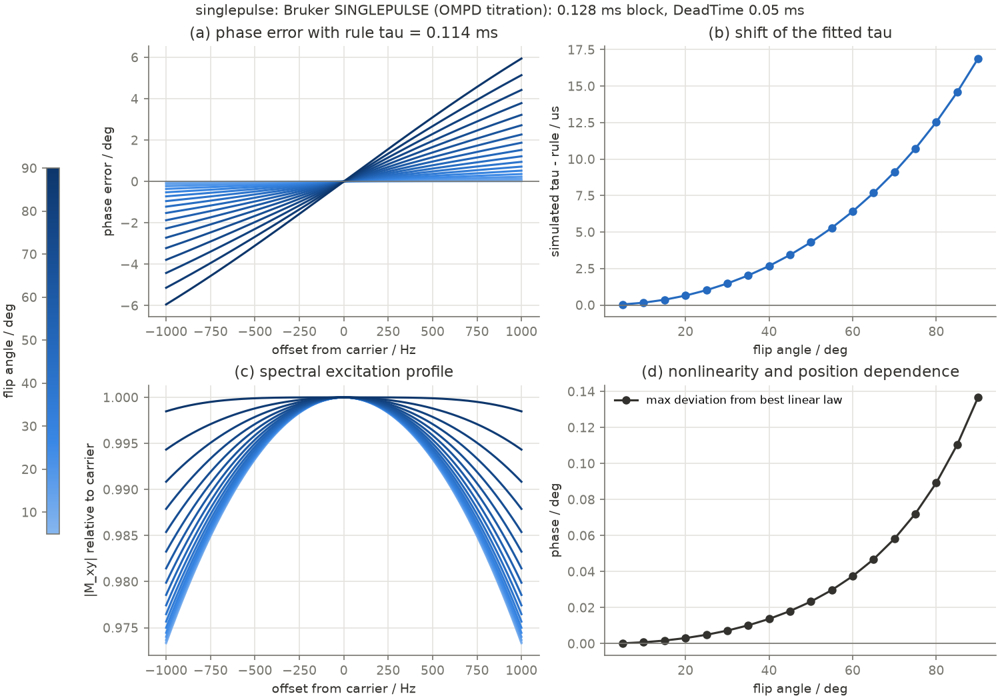
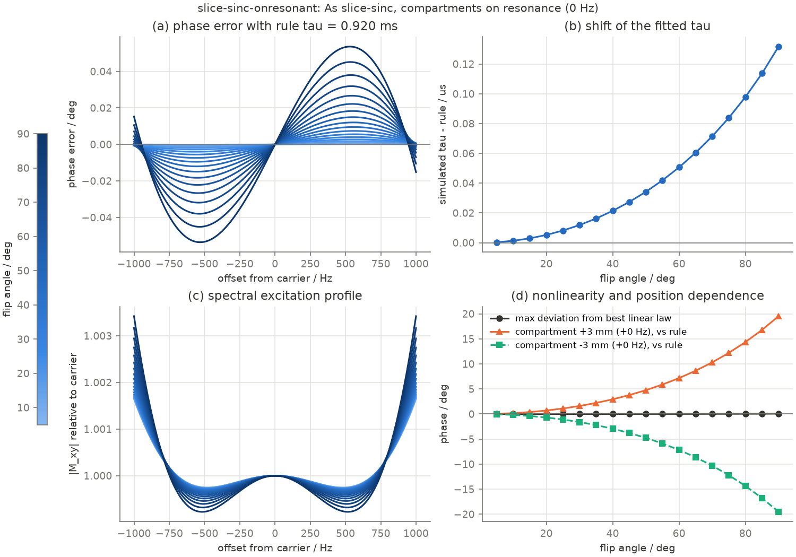
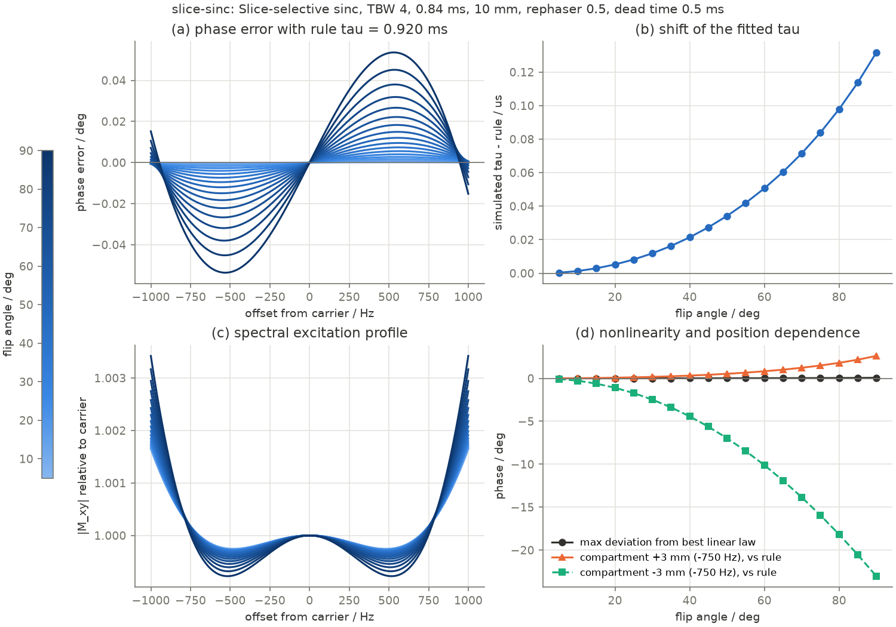
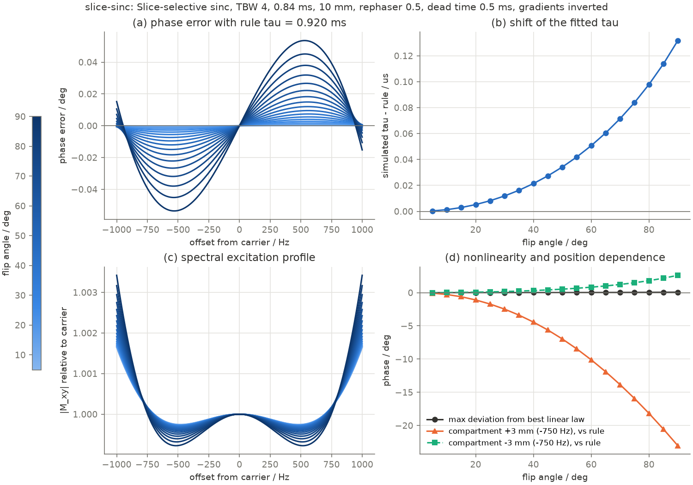
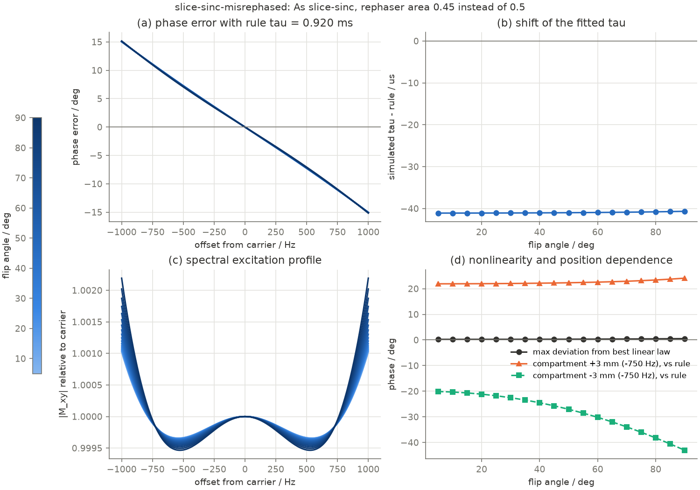

# Phase evolution of FID lines: Bloch simulation

The phase band of the FID fit assumes that every spectral line has the phase

$$\arg a_k = \varphi_0 + 2\pi f_k \tau ,$$

with one common $\varphi_0$ and one delay $\tau$ from the excitation isodelay
to the first sample. `phase_band_tau_s_from_scan` predicts the spin part of
$\tau$ as

$$\tau_\text{rule} = t_\text{pulse}\,\frac{R_\text{p}}{100} + t_\text{dead},$$

where $R_\text{p}$ is the rephasing factor in percent (50 for symmetric
pulses). This page checks the rule with Bloch simulations of the excitation
and the time up to the first sample.

## Method

`scripts/simulate_fid_phase_timing.py` uses
[blochsimulator](https://github.com/LucaNagel/bloch_sim_gui) to compute the
transverse magnetization at the first sample for 401 lines over
$\pm 1000$ Hz (5 Hz spacing) and flip angles from 5° to 90°. For each flip
angle it fits $\varphi_0$ and $\tau$ to the line phases, with magnitude
weights. Relaxation is switched off because it changes amplitudes, not
phases. For slice-selective excitation, two additional 2 mm compartments at
$\pm 3$ mm show whether the phase depends on the position in the slice.

Not simulated: the digital filter, the receiver delay and the empirical extra
dwell of `phase_band_tau_s_from_scan`. These add to the simulated $\tau$.

Reproduce all figures with

```bash
python scripts/simulate_fid_phase_timing.py --scenario all --plot fid_phase
python scripts/simulate_fid_phase_timing.py --scenario slice-sinc --flip-gradient \
    --plot fid_phase_slice_sinc_flipped.png
```

## Scenarios

| Scenario | Pulse | Gradients | $\tau_\text{rule}$ |
|---|---|---|---|
| `singlepulse` | 0.128 ms block (Bruker SINGLEPULSE) | none, dead time 0.05 ms | 0.114 ms |
| `slice-sinc` | 0.84 ms sinc, TBW 4 | 10 mm slice, rephaser area 0.5, dead time 0.5 ms; compartments at −750 Hz | 0.920 ms |
| `slice-sinc-onresonant` | as `slice-sinc` | compartments at 0 Hz | 0.920 ms |
| `slice-sinc-misrephased` | as `slice-sinc` | rephaser area 0.45 | 0.920 ms |

## Results

| Scenario | Quantity | 5° | 30° | 60° | 90° |
|---|---|---|---|---|---|
| `singlepulse` | $\tau - \tau_\text{rule}$ / µs | 0.0 | +1.5 | +6.4 | +16.9 |
| | phase error at ±1000 Hz / deg | ±0.0 | ±0.5 | ±2.3 | ±5.9 |
| `slice-sinc` | $\tau - \tau_\text{rule}$ / µs | 0.0 | 0.0 | +0.05 | +0.13 |
| | compartments +3 / −3 mm (−750 Hz) / deg | 0.0 / −0.1 | +0.2 / −2.5 | +0.8 / −10.1 | +2.6 / −23.0 |
| `slice-sinc-onresonant` | compartments +3 / −3 mm (0 Hz) / deg | ±0.04 | ±1.6 | ±7.2 | ±19.5 |
| `slice-sinc-misrephased` | $\tau - \tau_\text{rule}$ / µs | −41.1 | −41.1 | −40.9 | −40.7 |
| | compartments +3 / −3 mm (−750 Hz) / deg | +21.9 / −20.1 | +22.0 / −22.5 | +22.6 / −30.2 | +24.1 / −43.0 |

Compartment phases are given relative to the phase that the rule predicts from
the slab-averaged line at the carrier. In every scenario the remaining
nonlinearity in frequency is below 0.6°.



*Block pulse of Bruker SINGLEPULSE. (a) Phase error when $\tau_\text{rule}$ is used; (b) shift of the fitted $\tau$; (c) spectral excitation profile; (d) largest deviation from the best linear law.*



*Slice-selective sinc with correct rephaser. The frequency dependence follows the rule, but at large flip angles the phase varies across the slice even on resonance (d).*



*As above, compartments at −750 Hz. Chemical-shift displacement moves the slice for this line by about 1.6 mm, so the −3 mm compartment lies closer to the slice edge and its phase deviates more (d).*



*As above with the slice gradient inverted (`--flip-gradient`). The slice for the −750 Hz line now shifts the other way, so the +3 and −3 mm compartments swap their phases (d); panels (a)–(c) are unchanged.*



*Rephaser area 0.45 instead of 0.5. The fitted $\tau$ is 41 µs shorter at every flip angle (b), and the compartments differ by more than 40° (d).*

## Conclusions

- **The linear phase law holds.** For all simulated pulses the line phases
  are linear in frequency to within a fraction of a degree. One $\tau$ per
  scan is sufficient.
- **For small flip angles the rule is exact.** Up to about 30°, the
  difference is at most 1.5 µs, or 0.5° at 1 kHz.
- **For large flip angles a block pulse shifts $\tau$.** The isodelay of a
  hard pulse moves towards its end, by +17 µs at 90° (about 6° at 1 kHz).
  For the OMPD titration this matters only if the actual flip angle is large.
- **At large flip angles a slice-selective pulse also changes the phase
  across the slice.** The 0.5 rephaser is exact only in the small-tip limit.
  At 90°, compartments at ±3 mm differ by about 40° even on resonance.
  Chemical-shift displacement makes this asymmetric for off-resonant lines.
  The asymmetry follows the sign of $f \cdot G_\text{slice}$: inverting the
  slice gradient (`--flip-gradient`) or moving the lines to +750 Hz swaps the
  +3 and −3 mm values exactly.
  A single $\tau$ cannot describe this. For 13C CSI with flip angles of 10–20°,
  it stays below 1°.
- **A wrong rephaser shifts $\tau$ and twists the phase.** With an area of
  0.45 instead of 0.5, $\tau$ is 41 µs shorter at every flip angle, and the
  compartments differ by more than 40°. If the fitted $\tau$ differs from
  the rule independently of the flip angle, the gradient timing is the first
  thing to check.

## Predicting line phases for a scan

`scripts/predict_fid_line_phase.py` takes the pulse, the slice selection and
$\tau$ of one scan and prints, for each line, the phase from the linear law
($360°\,f\,\tau$), the Bloch-simulated phase and their difference, relative
to the carrier line. The slice offset is included: the RF is frequency
modulated to excite the shifted slice. For a uniform object this changes only
$\varphi_0$. For example, for a 0.84 ms SLR pulse (bandwidth 5000 Hz,
sharpness 3, 8°) with a 3 mm slice 1.445 mm off centre and
$\tau = 1.59027$ ms from `phase_band_tau_s_from_scan`:

```bash
python scripts/predict_fid_line_phase.py --pulse slr --duration-ms 0.84 \
    --bandwidth-hz 5000 --slr-sharpness 3 --flip-deg 8 --slice-mm 3 \
    --slice-offset-mm 1.44547 --tau-ms 1.59027 --span-hz 3000 --step-hz 250
```

Here law and simulation agree to within 0.01° over ±1500 Hz. With a
rephaser area of 0.45 instead of 0.5, the lines at ±1500 Hz deviate by
±23° (the fitted $\tau$ is 42 µs shorter).

## Related literature

- Delays before acquisition cause a first-order (linear) phase; the Bruker
  digital-filter group delay is removed in
  [nmrglue](https://github.com/jjhelmus/nmrglue/wiki/Processing-1D-Bruker-Data)
  and [PepsNMR](https://rdrr.io/bioc/PepsNMR/man/GroupDelayCorrection.html).
- FID-MRSI with a missing initial FID: correction by backward linear
  prediction or with a first-order phase in the basis set
  ([PMC3912904](https://pmc.ncbi.nlm.nih.gov/articles/PMC3912904),
  [PMC11638761](https://pmc.ncbi.nlm.nih.gov/articles/PMC11638761)).
- Hyperpolarized 13C EPSI and spiral CSI: linear phase corrections for
  chemical-shift displacement
  ([PMC3072043](https://pmc.ncbi.nlm.nih.gov/articles/PMC3072043)).
